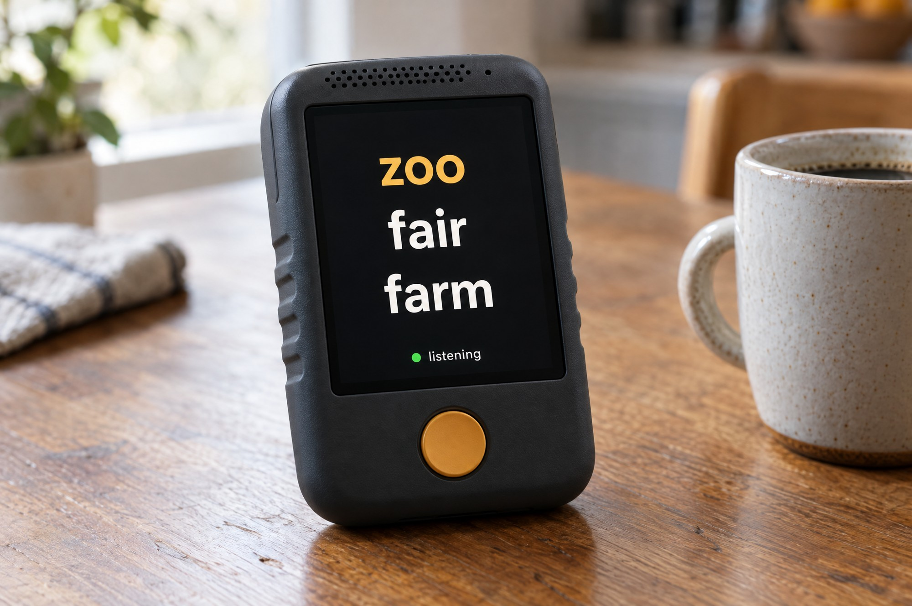

# Nudge

An offline, handheld word-finding aid for people with post-stroke aphasia.



Nudge listens to the conversation on-device. When the speaker stalls on a word and presses
the button, it shows and says the three words they most likely meant, in about a second,
with no internet. They say the word themselves. Nothing leaves the device.

- **Recognition over retrieval.** Anomia is a retrieval problem. Three candidates, best first.
- **They say the word.** The device never speaks into the conversation on their behalf.
- **One second.** A smarter answer at three seconds loses the conversation.
- **Their world.** A personal lexicon (names, places, meds, hobbies) rides in every prompt.
- **Nothing leaves the box.** Audio is transcribed in RAM and discarded. No network needed.

## Status (Nov 5, 2026)

Software is complete for v1 and tested as far as it can be without the hardware. The first
unit's compute module arrives today.

| Piece | State |
| --- | --- |
| Aphasia prompt + resolver + prefix cache | done, tested on CPU |
| Sound-alike engine (CMUdict + wordfreq, gated) | done; sound swaps 50% → 70% |
| Personal lexicon + confirmed-word boosting | done |
| 60 s ring buffer | done |
| Stall test harness, 46 synthetic cases | done; best 63% top-3 on Qwen2.5-3B Q4 |
| Service loop, button events, empty-tail guard | done, smoke-tested in `--dev` |
| Touchscreen kiosk UI + family page + stall log | done |
| whisper-stream listener, Piper speaker | written; needs the Jetson to test |
| XIAO RP2040 button firmware | written; needs the board to flash |
| Jetson setup script + systemd units | written; runs on first boot |
| Recording ingest → real stall set | written; needs a recording |

Accuracy so far, CPU, 46 synthetic stalls, top-3:

| Config | ALL | anomic | sound | semantic | circumlocution |
| --- | --- | --- | --- | --- | --- |
| Qwen2.5 1.5B, naive prompt | 11% | | | | |
| Qwen2.5 1.5B, aphasia prompt | 35% | | | | |
| Qwen2.5 3B, aphasia prompt | 59% | 58% | 50% | 50% | 80% |
| Qwen2.5 3B + hints everywhere | 41% | 42% | 50% | 40% | 50% |
| **Qwen2.5 3B + gated hints** | **63%** | 67% | 70% | 50% | 70% |

Gate to the field unit: 80% top-3 on real stalls, under 1.5 s. The 7B/8B on the Jetson GPU is the next lever.

## Hardware (v1 handheld)

One sealed unit, ~100 × 160 × 48 mm, USB-C charged. Jetson Orin NX 16GB (Seeed reComputer Mini J4012),
5" 800×480 touch panel via USB-C→HDMI, 40 mm speaker + PAM8403, electret mic via USB codec, 30 mm arcade
button through a XIAO RP2040 (USB HID), 4× 21700 cells (4S) with an IP2368 USB-C charger board.
Full BOM and exploded view in `docs/`.

## Layout

```
nudge/
  prompt.py      the aphasia prompt
  resolver.py    backend + three-word parser + said-word filter
  phono.py       sound-alike hints (gated on a finished phrase)
  lexicon.py     his world, plus confirmed words
  ring.py        60 s rolling transcript, RAM only
  listener.py    whisper-stream → ring (TypedListener for dev)
  speak.py       Piper → speaker (PrintSpeaker for dev)
  button.py      evdev reader for the XIAO; Button.fire() event bus
  screen.py      HTTP + SSE server for the kiosk page and the family page
  static/        index.html (kiosk), family.html (lexicon editor, log)
  log.py         opt-in CSV stall log
  service.py     the loop
tests/harness.py            scores top-1/top-3 on tests/stalls/{stalls,real}.yaml
tools/ingest_recording.py   recording → transcript → suspected stalls → review YAML → real.yaml
firmware/xiao_button/       Arduino sketch: F13/F14/F15 on click/double/long
scripts/jetson_setup.sh     one-shot CUDA builds, models, systemd, kiosk
```

## Run

On the Jetson (JetPack 6):

```
git clone https://github.com/albertjonasbrand/nudge ~/nudge && cd ~/nudge
./scripts/jetson_setup.sh                     # ~1 h first time; MODEL=qwen2.5-7b for the bigger model
python3 -m tests.harness --model models/qwen2.5-3b-instruct-q4_k_m.gguf
sudo systemctl start nudge nudge-kiosk
```

Anywhere, no hardware:

```
pip install -r requirements.txt
python3 -m tests.harness --model models/<any>.gguf
python3 -m nudge.service --dev                # type lines; blank line = press
```

From a recording of the user:

```
pip install faster-whisper pyannote.audio
python3 tools/ingest_recording.py call.m4a --diarize --dad first
# fill in target words in tests/stalls/review/call.yaml, then
python3 tools/ingest_recording.py --merge tests/stalls/review/call.yaml
python3 -m tests.harness --set real --model models/<any>.gguf
```

## Morning checklist

1. Unbox the Jetson. Connect a monitor (Anker USB-C→HDMI), keyboard, Wi-Fi.
2. Clone the repo and run `scripts/jetson_setup.sh`.
3. Run the harness on the GPU with the 3B, then `MODEL=qwen2.5-7b` and compare.
4. Plug in the Sabrent adapter + mic + speaker; `python3 -m nudge.service` and talk to it.
5. Flash the XIAO, wire the button, press it.
6. Record a call with Dad; ingest; tune on real stalls.
